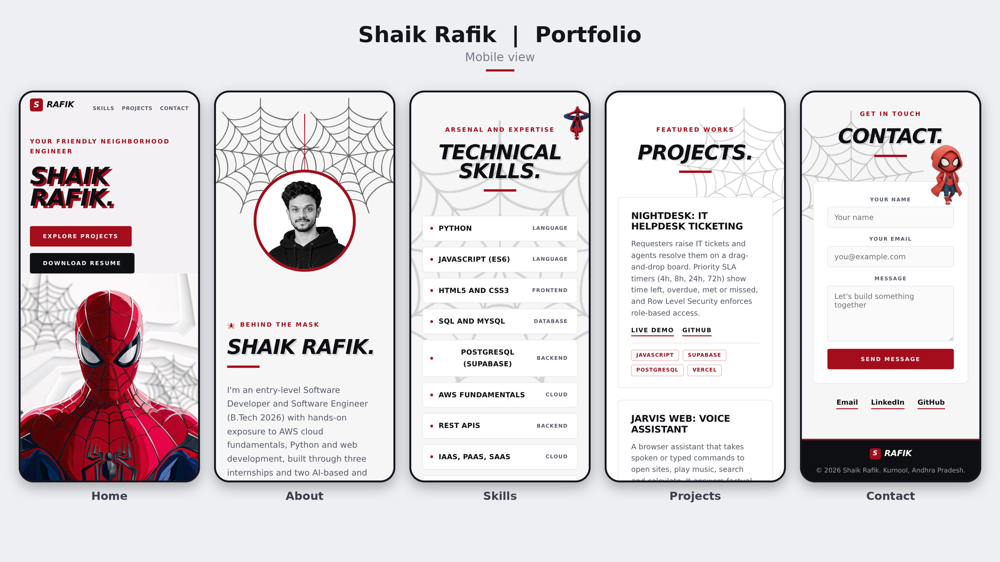

# Shaik Rafik | Portfolio

An animated, Spider-Man-themed personal portfolio for **Shaik Rafik**, an entry-level Software Engineer (B.Tech CSE, 2026) working with Python, JavaScript, SQL and AWS.

It is a single `index.html` file built with plain HTML, CSS and JavaScript, with [GSAP](https://gsap.com/) and ScrollTrigger for the animation. There is no build step and nothing to install.

**Live site:** https://shaikrafikportfolio.vercel.app/

## Preview



*Mobile view: Home, About, Technical Skills, Projects and Contact.*

---

## Features

- **Hero:** Spider-Man in the center with an animated name entrance and corner webs. Move the mouse over him and a soft circle follows the cursor, revealing my face on his mask. On touch screens the circle drifts on its own.
- **Scrolling bands:** two tilted black and red ribbons (Full Stack Engineer, Python, AWS Cloud, Web Development, Supabase, PostgreSQL, JavaScript, REST APIs).
- **About:** my photo in a round frame hangs from a thread, swings gently and glows. It starts in grayscale and turns to color when you hover over it. The webs at the top corners rotate slowly, the paragraphs flip in with a 3D reveal, and the tech pills scale in one after another and then float.
- **Technical skills:** two-column list where each row fills red on hover, with a Spider-Man hanging beside it.
- **Projects:**
  - **Nightdesk**, an IT helpdesk ticketing system with a drag-and-drop board, priority SLA timers and role-based access.
  - **Jarvis Web**, a browser voice assistant using the Web Speech API and Wikipedia API.
  - A Spider-Man slides in from the left and sways beside the cards.
- **Contact:** a contact form, a mini Spider-Man, and Email, LinkedIn and GitHub buttons.
- **Footer:** a slim dark bar with a red top line, my "S RAFIK" logo on the left and the copyright line on the right.
- **Download Resume:** one click saves `Shaik_Rafik_Resume.pdf`. The PDF is built into the page, so the button works without any extra file.
- **Email, LinkedIn and GitHub buttons:** each opens directly in a new tab. Email opens a Gmail "new message" addressed to me, and the address is not shown on the page.
- **Browser tab icon:** my photo appears in the tab instead of the default globe.
- **Responsive and accessible:** works from phones to wide desktops, keyboard focus outlines are visible, and animations are skipped for visitors who prefer reduced motion.

---

## Tech stack

| Area | Tools |
|---|---|
| Markup and styling | HTML5, CSS3 (custom properties, grid, flexbox, `mask-image`, `clip-path`) |
| Scripting | Vanilla JavaScript (ES6) |
| Animation | GSAP 3.12.5 and ScrollTrigger (loaded from cdnjs) |
| Font | Outfit (Google Fonts) |
| Hosting | Vercel (deployed from GitHub) |

---

## Project structure

```
portfolio-v3/
├── index.html            # the whole portfolio (images, icon and resume are embedded)
├── Shaik_Rafik_Resume.pdf
├── assets/               # original cut-out images, kept for editing
├── screenshots/
│   └── 07-mobile.png     # preview image used above
└── README.md
```

---

## Run it locally

1. Download or clone the repository.
2. Open `index.html` in a browser. You need an internet connection, because GSAP and the font load from a CDN.

Optional local server:

```bash
python -m http.server 8000
# then open http://localhost:8000
```

---

## Deploy to Vercel

1. Push the folder to a GitHub repository.
2. In Vercel, choose **Add New, Project** and import the repository.
3. Leave the framework preset on **Other**. There is no build command and no output directory.
4. Click **Deploy**.

---

## Customize it

- **Text and sections:** edit `index.html`. The sections have the ids `hero`, `about`, `skills`, `projects` and `contact`.
- **Colors:** change the CSS variables at the top of the `<style>` block (`--red`, `--ink`, `--bg` and so on).
- **Project links:** update the `Live demo` and `GitHub` links inside the two `.card` blocks in the Projects section.
- **Images:** the images are embedded in the `IMG` object near the bottom of `index.html`. Replace a value with your own data URI, or point an `` at a normal file path instead.
- **Tab icon:** it is the `<link rel="icon">` tag in the `<head>`, also embedded as a data URI.
- **Resume:** the PDF is embedded in the `PDF` variable. To update it, run `base64 -w0 Shaik_Rafik_Resume.pdf` and paste the result over the old value.

---

## Credits and notice

- The Spider-Man artwork and character belong to **Marvel / Disney**. They are used here only for a personal, non-commercial, fan-style portfolio. Replace them with your own artwork before using this design commercially.
- Design inspired by a creator portfolio shown in a video reference. All text, structure and code here are my own.

---

## Contact

**Shaik Rafik**, Kurnool, Andhra Pradesh, India

- Portfolio: https://shaikrafikportfolio.vercel.app/
- GitHub: https://github.com/RafikShaik07
- LinkedIn: https://www.linkedin.com/in/shaik-rafik-79a7253a9/
- Email: srafiqshaik07@gmail.com
